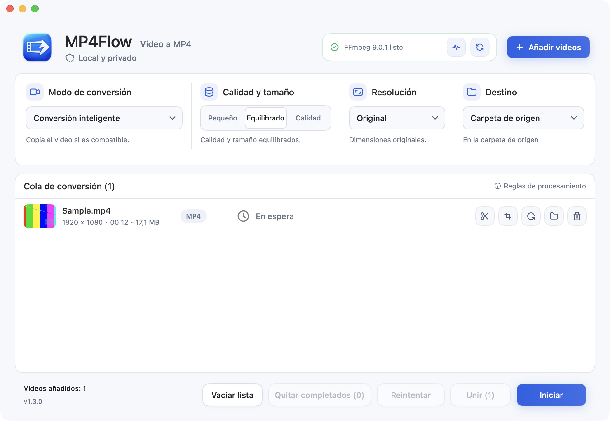

# MP4Flow

[English](README.md) · [简体中文](README.zh-CN.md) · [Français](README.fr.md) · [Русский](README.ru.md) · [Español](README.es.md) · [日本語](README.ja.md) · [한국어](README.ko.md)

**Video a MP4. Así de fácil.** Una app nativa para Mac, gratis y de código abierto. Sin cuentas ni subir videos.

[**Descargar para Mac**](https://github.com/ixiehao/MP4Flow/releases/latest) · [Sitio oficial](https://ixiehao.github.io/MP4Flow/es/) · [Informar de un problema](https://github.com/ixiehao/MP4Flow/issues/new/choose)

**Requisitos:** macOS 13+ · Mac con Apple Silicon o Intel · FFmpeg y ffprobe (instalación abajo).

## Funciones principales

| Función | Para qué sirve |
| --- | --- |
| **Conversión inteligente** | Convierte un video o varios a la vez. Copia sin recodificar cuando sea posible y usa aceleración por hardware si está disponible. |
| **Unir clips** | Une clips sin editar en el orden de la cola. Unión directa si son compatibles, o con recodificación para igualar formatos. |
| **Cortar** | Elige el inicio y el final. Conserva solo el fragmento que quieres. |
| **Recortar** | Arrastra el marco o introduce las dimensiones para quitar bordes. |
| **Girar** | Gira el video 90° o 180° manteniendo sus proporciones. |
| **Corregir proporción** | Corrige imágenes estiradas con vista previa en tiempo real y proporciones predefinidas o personalizadas. |
| **Aclarar imagen** | Ajusta el brillo y aclara las sombras con suavidad. Mira el resultado mientras editas. |
| **Reducir ruido** | Reduce el grano en escenas oscuras. Activa una reducción ligera de ruido cuando la necesites. |

En la cola, abre **Editar video** para recortar o corregir la proporción. El brillo y el ruido se ajustan en **Ajustes de imagen**. Pulsa **Aplicar** y luego **Iniciar** para exportar.

Los ajustes de imagen requieren recodificar y no admiten HDR. La reducción de ruido está desactivada por defecto y puede suavizar los detalles.

También puedes cambiar la resolución de salida. Todo el procesamiento de video se hace en tu Mac.

## Descargar e instalar

1. **Instala la app.** Abre la [última versión](https://github.com/ixiehao/MP4Flow/releases/latest), despliega **Assets** y descarga el **instalador `.dmg` de MP4Flow**. Ábrelo y arrastra **MP4Flow** a **Applications (Aplicaciones)**.
2. **Instala las herramientas de video una vez.** Abre **Terminal** con Spotlight (`⌘ Espacio`). Si no tienes Homebrew, [instálalo](https://brew.sh/) y completa sus **Next steps**. Después ejecuta:

   ```sh
   brew install ffmpeg
   ```

   Esto instala FFmpeg y ffprobe. Homebrew tiene sus propios [requisitos del sistema](https://docs.brew.sh/Installation#macos-requirements).

3. **Convierte tu primer video.** Añádelo a MP4Flow, mantén **Conversión inteligente**, elige la calidad y pulsa **Iniciar**.

Por defecto, el resultado se guarda junto al original sin sobrescribir archivos existentes. Pulsa **Abrir carpeta** para encontrarlo. Cambia el idioma desde **Idioma** en la barra de menús del Mac.

<details>
<summary>Ver la app</summary>



</details>

## ¿Necesitas ayuda?

- **¿No encuentra FFmpeg o ffprobe?** Tras instalarlos, abre **Diagnóstico → Comprobar de nuevo**. MP4Flow no incluye estas herramientas.
- **¿macOS bloquea la apertura?** La versión de GitHub no está notarizada por Apple. Comprueba el origen de la descarga y sigue las [instrucciones de Apple](https://support.apple.com/es-es/102445).
- **¿Falló la conversión?** Pulsa **Reintentar**. Si falla una edición o ampliación, crea primero un MP4 con **Conversión inteligente** y añade ese archivo nuevo. Si persiste, [informa del error](https://github.com/ixiehao/MP4Flow/issues/new/choose) con las versiones de macOS y de la app. No adjuntes videos privados.

## Antes de convertir

MP4Flow omite portadas y miniaturas, conserva la primera pista de video real y la primera de audio, y elimina los metadatos del contenedor y los capítulos. Consulta los avisos de la app sobre pistas adicionales, subtítulos y HDR.

<details>
<summary>Opcional: ampliación inteligente</summary>

Esta función experimental requiere Apple Silicon, macOS 27+ y un factor de ampliación admitido por VideoToolbox de Apple. No se puede combinar con recorte, giro, corrección de proporción ni ajustes de imagen. macOS puede descargar un modelo del sistema en el primer uso. Cambiar la resolución de forma normal no recupera detalles perdidos.

</details>

## Código abierto y licencias

Por [ixiehao](https://github.com/ixiehao) · [Licencia MIT](LICENSE). Usa las fuentes de macOS y [Tabler Icons Outline](https://github.com/tabler/tabler-icons) ([aviso MIT](AppResources/ASSET_NOTICES.md)). FFmpeg se instala por separado; su licencia depende de la compilación.

[Compilar el código](docs/DEVELOPMENT.md) · [Contribuir](CONTRIBUTING.md) · [Privacidad](PRIVACY.md) · [Avisos de terceros](NOTICE.md)
