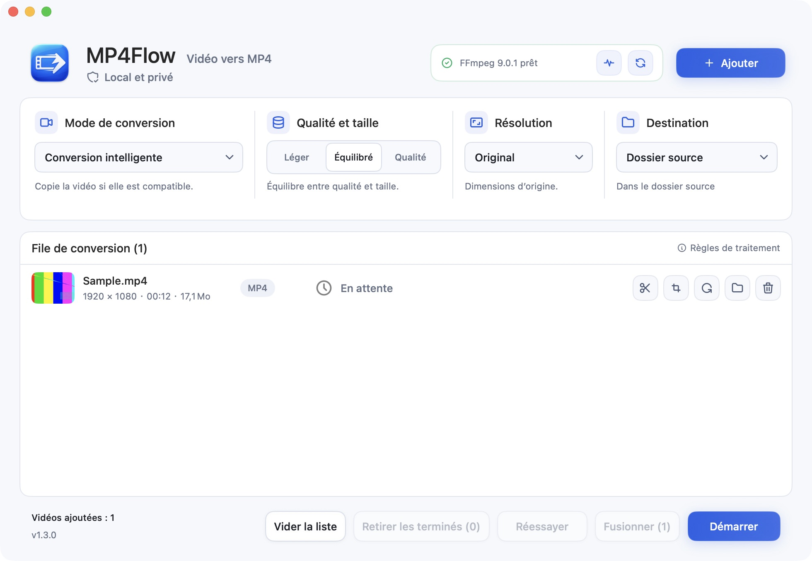

# MP4Flow

[English](README.md) · [简体中文](README.zh-CN.md) · [Français](README.fr.md) · [Русский](README.ru.md) · [Español](README.es.md) · [日本語](README.ja.md) · [한국어](README.ko.md)

**Vos vidéos en MP4. Tout simplement.** Une app Mac native, gratuite et open source. Sans compte ni envoi de vidéos.

[**Télécharger pour Mac**](https://github.com/ixiehao/MP4Flow/releases/latest) · [Site officiel](https://ixiehao.github.io/MP4Flow/fr/) · [Signaler un problème](https://github.com/ixiehao/MP4Flow/issues/new/choose)

**Prérequis :** macOS 13+ · Mac Apple Silicon ou Intel · FFmpeg et ffprobe (installation ci-dessous).

## Les fonctions essentielles

| Fonction | Pour… |
| --- | --- |
| **Conversion intelligente** | Convertissez une vidéo ou un lot. Copie sans réencodage si possible, accélération matérielle si disponible. |
| **Fusionner** | Assemblez les séquences non modifiées dans l’ordre de la file. Fusion directe si compatible, ou fusion avec réencodage pour uniformiser les formats. |
| **Découper** | Définissez le début et la fin. Gardez seulement le passage voulu. |
| **Recadrer** | Déplacez le cadre ou saisissez les dimensions pour enlever les bords inutiles. |
| **Pivoter** | Tournez la vidéo de 90° ou 180° sans modifier ses proportions. |
| **Correction du ratio** | Corrigez une image étirée avec aperçu en direct, ratios prédéfinis ou personnalisés. |
| **Éclaircir l’image** | Réglez la luminosité et éclaircissez les ombres en douceur, avec aperçu en direct. |
| **Réduire le bruit** | Atténuez le grain dans les scènes sombres. Activez une réduction légère du bruit au besoin. |

Dans la file, ouvrez **Modifier la vidéo** pour recadrer ou corriger le ratio. La luminosité et le bruit se règlent dans **Réglage de l’image**. Cliquez sur **Appliquer**, puis **Démarrer** pour exporter.

Les réglages d’image nécessitent un réencodage et ne prennent pas en charge le HDR. La réduction du bruit est désactivée par défaut et peut adoucir les détails.

Vous pouvez aussi changer la résolution de sortie. Tout le traitement vidéo se fait sur votre Mac.

## Télécharger et installer

1. **Installez l’app.** Ouvrez la [dernière version](https://github.com/ixiehao/MP4Flow/releases/latest), dépliez **Assets** et téléchargez le **fichier `.dmg` de MP4Flow**. Ouvrez-le, puis glissez **MP4Flow** dans **Applications**.
2. **Installez les outils vidéo une seule fois.** Ouvrez **Terminal** avec Spotlight (`⌘ Espace`). Au besoin, [installez Homebrew](https://brew.sh/) et suivez ses **Next steps** jusqu’au bout. Exécutez ensuite :

   ```sh
   brew install ffmpeg
   ```

   Cette commande installe FFmpeg et ffprobe. Homebrew a ses propres [prérequis système](https://docs.brew.sh/Installation#macos-requirements).

3. **Convertissez votre première vidéo.** Ajoutez-la dans MP4Flow, gardez **Conversion intelligente**, choisissez la qualité et cliquez sur **Démarrer**.

Par défaut, le résultat est enregistré dans le dossier d’origine, sans écraser les fichiers existants. Cliquez sur **Ouvrir le dossier** pour le retrouver. Changez la langue via **Langue** dans la barre des menus du Mac.

<details>
<summary>Voir l’app</summary>



</details>

## Besoin d’aide ?

- **FFmpeg ou ffprobe introuvable ?** Après l’installation, ouvrez **Diagnostic → Revérifier**. Ces outils ne sont pas inclus dans MP4Flow.
- **macOS bloque l’ouverture ?** La version GitHub n’est pas notariée par Apple. Vérifiez sa provenance, puis suivez les [instructions d’Apple](https://support.apple.com/fr-fr/102445).
- **Une conversion échoue ?** Cliquez sur **Réessayer**. Si une retouche ou un agrandissement échoue, créez d’abord un MP4 avec **Conversion intelligente**, puis ajoutez ce nouveau fichier. Si nécessaire, [signalez l’erreur](https://github.com/ixiehao/MP4Flow/issues/new/choose) avec les versions de macOS et de l’app, sans joindre de vidéos privées.

## Avant de convertir

MP4Flow ignore les pochettes et miniatures, conserve la première vraie piste vidéo et la première piste audio, et retire les métadonnées du conteneur et les chapitres. Consultez les notices de l’app pour les pistes supplémentaires, les sous-titres et le HDR.

<details>
<summary>En option : agrandissement intelligent</summary>

Cette fonction expérimentale nécessite Apple Silicon, macOS 27+ et un facteur d’agrandissement pris en charge par VideoToolbox d’Apple. Elle ne se combine pas avec le recadrage, la rotation, la correction du ratio ou les réglages d’image. macOS peut télécharger un modèle système au premier usage. Un redimensionnement ordinaire ne restaure pas les détails manquants.

</details>

## Code ouvert et licences

Par [ixiehao](https://github.com/ixiehao) · [Licence MIT](LICENSE). Utilise les polices de macOS et [Tabler Icons Outline](https://github.com/tabler/tabler-icons) ([notice MIT](AppResources/ASSET_NOTICES.md)). FFmpeg s’installe séparément ; sa licence dépend de la version compilée.

[Compiler les sources](docs/DEVELOPMENT.md) · [Contribuer](CONTRIBUTING.md) · [Confidentialité](PRIVACY.md) · [Mentions tierces](NOTICE.md)
