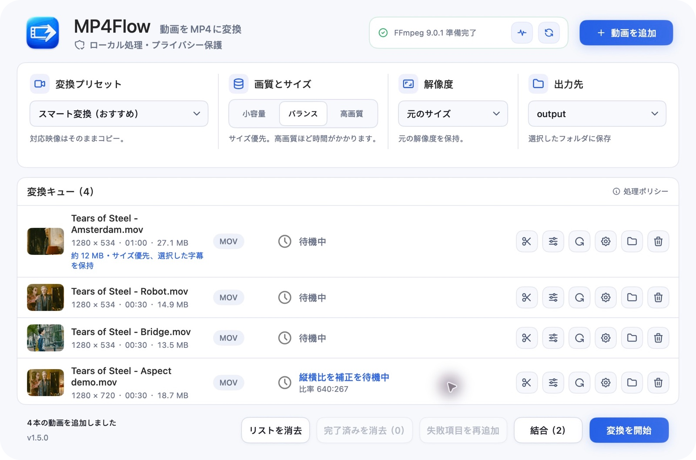
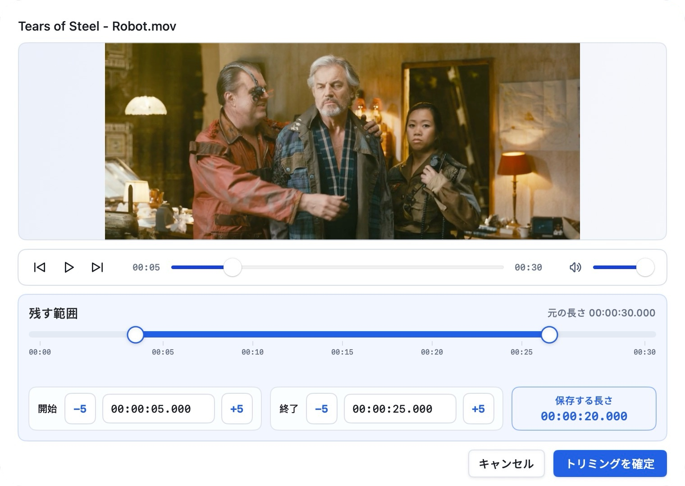
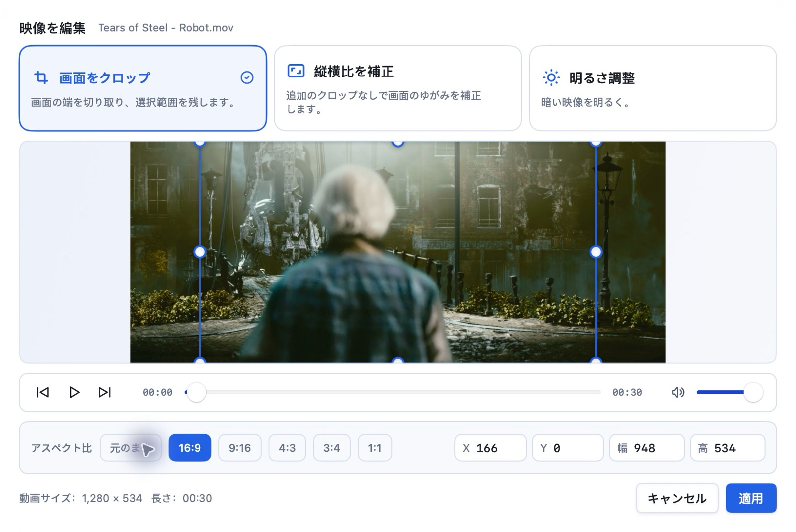
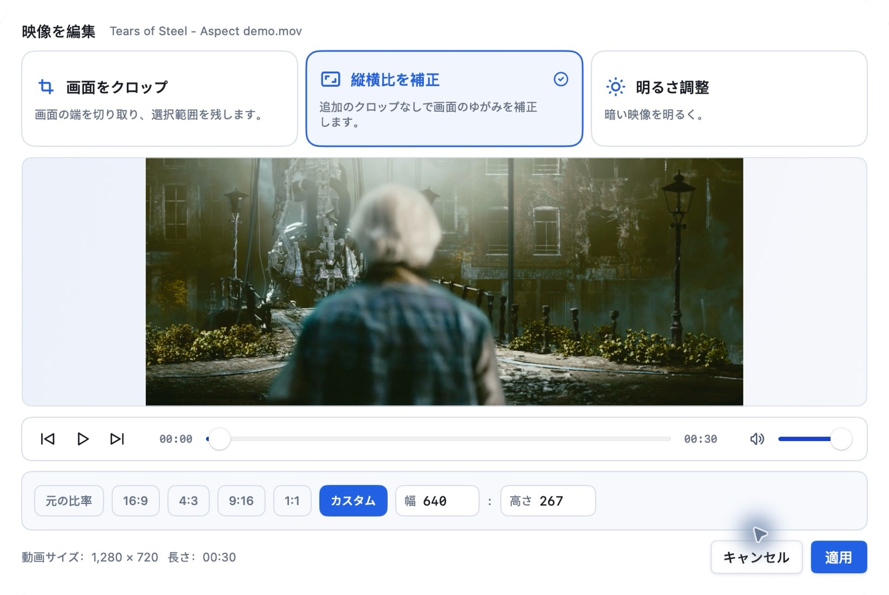
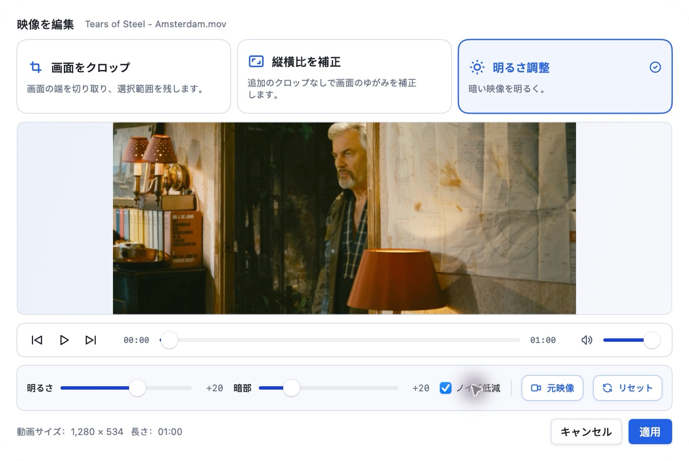
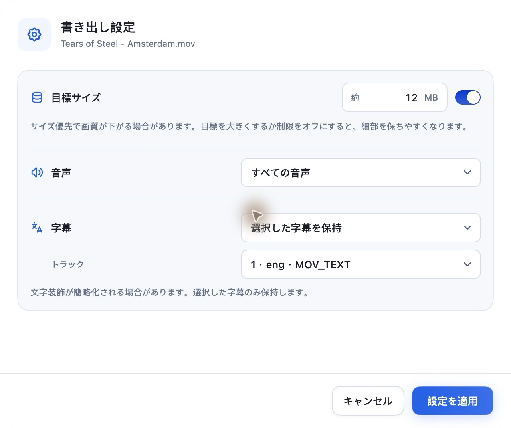

# MP4Flow

[English](README.md) · [简体中文](README.zh-CN.md) · [Français](README.fr.md) · [Русский](README.ru.md) · [Español](README.es.md) · [日本語](README.ja.md) · [한국어](README.ko.md)

**動画を MP4 に。もっと簡単に。** 無料・オープンソースの Mac ネイティブアプリ。ログインも動画のアップロードも不要です。

[**Mac 版をダウンロード**](https://github.com/ixiehao/MP4Flow/releases/latest) · [公式サイト](https://ixiehao.github.io/MP4Flow/ja/) · [不具合を報告](https://github.com/ixiehao/MP4Flow/issues/new/choose)

**動作環境：** macOS 13+ · Appleシリコンまたは Intel · FFmpeg と ffprobe（導入方法は下記）。



## 主な機能

| 機能 | できること |
| --- | --- |
| **スマート変換** | 1本でもまとめてもMP4に。可能なら再エンコードせず、利用できる場合はハードウェアで高速化。 |
| **動画を結合** | 未編集の動画をキューの順に1本に。形式が合えばそのまま結合し、異なる場合は再エンコードで統一。 |
| **書き出し設定** | 目標サイズと音声トラックを指定。文字字幕の保持・焼き込みにも対応。 |
| **キューの復元** | キューと設定を保存。次回起動時に未完了の処理をやり直せます。 |
| **トリミング** | 開始・終了位置を指定し、必要な場面だけを残します。 |
| **クロップ** | 枠をドラッグするかサイズを入力して、余分な画面の端を取り除きます。 |
| **回転** | 縦横比を保ったまま、90° または 180° 回転します。 |
| **縦横比を補正** | 引き伸ばされた映像を補正。リアルタイムプレビュー、プリセット、カスタム比率に対応。 |
| **映像を明るく** | 明るさと暗部を穏やかに調整。プレビューを見ながら仕上がりを確認。 |
| **軽いノイズ低減** | 暗い場面のざらつきを軽減。必要なときだけ、軽いノイズ低減をオンに。 |

キューの **映像を編集** でクロップや縦横比を補正。明るさとノイズ低減は **明るさ調整** にあります。**適用** を押してから **変換を開始** で書き出します。

明るさ調整は再エンコードが必要で、HDRは非対応です。ノイズ低減は初期設定でオフ。細部がやや柔らかくなる場合があります。

出力解像度の変更にも対応。動画はMac内で処理します。

## ダウンロードと導入

1. **アプリを入れる。** [最新リリース](https://github.com/ixiehao/MP4Flow/releases/latest)の **Assets** を開き、**MP4Flow の `.dmg` ファイル**をダウンロード。開いて **MP4Flow** を **Applications（アプリケーション）** にドラッグします。
2. **動画ツールを一度だけ入れる。** `⌘ スペース` で「ターミナル」を検索して開きます。Homebrew がなければ[公式の手順](https://brew.sh/)で導入し、最後に表示される **Next steps** まで完了してください。その後、次を実行します。

   ```sh
   brew install ffmpeg
   ```

   FFmpeg と ffprobe の両方が入ります。Homebrew の[動作要件](https://docs.brew.sh/Installation#macos-requirements)は MP4Flow とは異なります。

3. **動画を変換する。** MP4Flow に動画を追加し、**スマート変換（おすすめ）** のまま画質を選び、**変換を開始** をクリックします。

初期設定では元動画と同じフォルダに保存し、既存ファイルは上書きしません。**フォルダを開く** から結果を確認できます。表示言語は Mac のメニューバーの **言語** で切り替えられます。

## 機能プレビュー

| **トリミング** | **クロップ** |
| :---: | :---: |
|  |  |
| **縦横比を補正** | **明るさとノイズ低減** |
|  |  |

**書き出し設定**



デモ映像：[Tears of Steel](https://mango.blender.org/) · (CC) Blender Foundation | mango.blender.org · [CC BY 3.0](https://creativecommons.org/licenses/by/3.0/)。映画の一部を編集して使用。画面写真は端の切り取り・縮小あり。[素材のクレジット](docs/MEDIA-CREDITS.md)。

## 困ったときは

- **FFmpeg や ffprobe が見つからない：** 導入後、**環境チェック → 再確認** を選びます。MP4Flow に両ツールは同梱されていません。
- **macOS に起動を止められる：** GitHub 版は Apple の公証を受けていません。入手元を確認し、[Apple の案内](https://support.apple.com/ja-jp/102445)に従って開いてください。
- **変換に失敗する：** **失敗項目を再追加** で再試行します。編集や高画質拡大の失敗なら、先にスマート変換で新しい MP4 を作り、そのファイルを追加して試してください。解決しない場合は macOS・アプリのバージョンとエラー文を添えて[報告](https://github.com/ixiehao/MP4Flow/issues/new/choose)してください。非公開動画の添付は不要です。

## 変換前に

カバー画像を除き、最初の映像とすべての音声トラックを既定で保持します。**書き出し設定** で音声、文字字幕、目標サイズを選べます。サイズは概算で、圧縮により画質が低下する場合があります。コンテナメタデータとチャプターは削除します。

文字字幕の焼き込みには libass 対応の FFmpeg（例：`brew install ffmpeg-full`）が必要です。字幕は既定では保持しません。キューと設定はこの Mac に保存され、未完了の処理は **変換を開始** を押すと最初から再実行します。

<details>
<summary>オプション：スマート高画質拡大</summary>

実験的な機能です。Appleシリコン、macOS 27+、Apple VideoToolbox が対応する拡大率が必要です。クロップ・回転・縦横比補正・明るさ調整とは併用できません。初回に macOS がシステムモデルをダウンロードする場合があります。通常の解像度変更では、失われた細部は復元できません。

</details>

## オープンソースとライセンス

開発者：[ixiehao](https://github.com/ixiehao) · [MIT License](LICENSE)。macOS 標準フォントと [Tabler Icons Outline](https://github.com/tabler/tabler-icons)（[MIT 表記](AppResources/ASSET_NOTICES.md)）を使用。FFmpeg は別途導入し、ライセンスはそのビルドに従います。

[ソースからビルド](docs/DEVELOPMENT.md) · [開発に参加](CONTRIBUTING.md) · [プライバシー](PRIVACY.ja.md) · [第三者の権利表記](NOTICE.ja.md)
