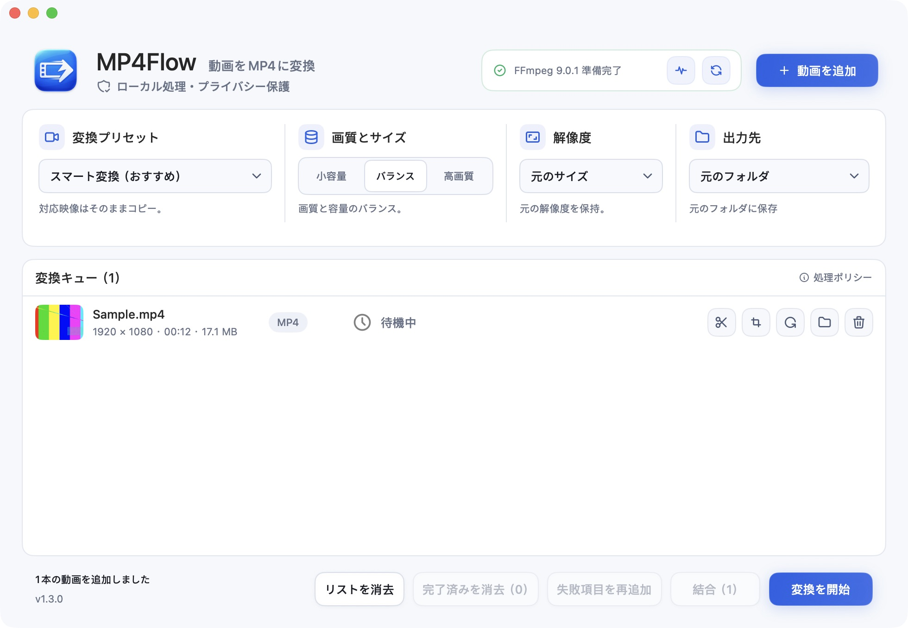

# MP4Flow

[English](README.md) · [简体中文](README.zh-CN.md) · [Français](README.fr.md) · [Русский](README.ru.md) · [Español](README.es.md) · [日本語](README.ja.md) · [한국어](README.ko.md)

**動画を MP4 に。もっと簡単に。** 無料・オープンソースの Mac ネイティブアプリ。ログインも動画のアップロードも不要です。

[**Mac 版をダウンロード**](https://github.com/ixiehao/MP4Flow/releases/latest) · [公式サイト](https://ixiehao.github.io/MP4Flow/ja/) · [不具合を報告](https://github.com/ixiehao/MP4Flow/issues/new/choose)

**動作環境：** macOS 13+ · Appleシリコンまたは Intel · FFmpeg と ffprobe（導入方法は下記）。

## 主な機能

| 機能 | できること |
| --- | --- |
| **スマート変換** | 不要な再エンコードを避け、利用可能ならハードウェアで高速化。 |
| **トリミング** | 開始・終了位置を選び、必要な場面だけを残す。 |
| **クロップ** | 画面の余分な端を取り除く。 |
| **回転** | 縦横比を保って動画の向きを直す。 |

一括変換、動画の結合、解像度の変更にも対応。動画は Mac 内で処理します。

## ダウンロードと導入

1. **アプリを入れる。** [最新リリース](https://github.com/ixiehao/MP4Flow/releases/latest)の **Assets** を開き、**MP4Flow の `.dmg` ファイル**をダウンロード。開いて **MP4Flow** を **Applications（アプリケーション）** にドラッグします。
2. **動画ツールを一度だけ入れる。** `⌘ スペース` で「ターミナル」を検索して開きます。Homebrew がなければ[公式の手順](https://brew.sh/)で導入し、最後に表示される **Next steps** まで完了してください。その後、次を実行します。

   ```sh
   brew install ffmpeg
   ```

   FFmpeg と ffprobe の両方が入ります。Homebrew の[動作要件](https://docs.brew.sh/Installation#macos-requirements)は MP4Flow とは異なります。

3. **動画を変換する。** MP4Flow に動画を追加し、**スマート変換（おすすめ）** のまま画質を選び、**変換を開始** をクリックします。

初期設定では元動画と同じフォルダに保存し、既存ファイルは上書きしません。**フォルダを開く** から結果を確認できます。表示言語は Mac のメニューバーの **言語** で切り替えられます。

<details>
<summary>アプリの画面を見る</summary>



</details>

## 困ったときは

- **FFmpeg や ffprobe が見つからない：** 導入後、**環境チェック → 再確認** を選びます。MP4Flow に両ツールは同梱されていません。
- **macOS に起動を止められる：** GitHub 版は Apple の公証を受けていません。入手元を確認し、[Apple の案内](https://support.apple.com/ja-jp/102445)に従って開いてください。
- **変換に失敗する：** **失敗項目を再追加** で再試行します。編集や高画質拡大の失敗なら、先にスマート変換で新しい MP4 を作り、そのファイルを追加して試してください。解決しない場合は macOS・アプリのバージョンとエラー文を添えて[報告](https://github.com/ixiehao/MP4Flow/issues/new/choose)してください。非公開動画の添付は不要です。

## 変換前に

カバー画像とサムネイルを除き、最初の映像・音声トラックを出力します。コンテナメタデータとチャプターは削除します。追加トラック、字幕、HDR の扱いはアプリ内の通知をご確認ください。

<details>
<summary>オプション：スマート高画質拡大</summary>

実験的な機能です。Appleシリコン、macOS 27+、Apple VideoToolbox が対応する拡大率が必要です。クロップや回転とは併用できません。初回に macOS がシステムモデルをダウンロードする場合があります。通常の解像度変更では、失われた細部は復元できません。

</details>

## オープンソースとライセンス

開発者：[ixiehao](https://github.com/ixiehao) · [MIT License](LICENSE)。macOS 標準フォントと [Tabler Icons Outline](https://github.com/tabler/tabler-icons)（[MIT 表記](AppResources/ASSET_NOTICES.md)）を使用。FFmpeg は別途導入し、ライセンスはそのビルドに従います。

[ソースからビルド](docs/DEVELOPMENT.md) · [開発に参加](CONTRIBUTING.md) · [プライバシー](PRIVACY.ja.md) · [第三者の権利表記](NOTICE.ja.md)
