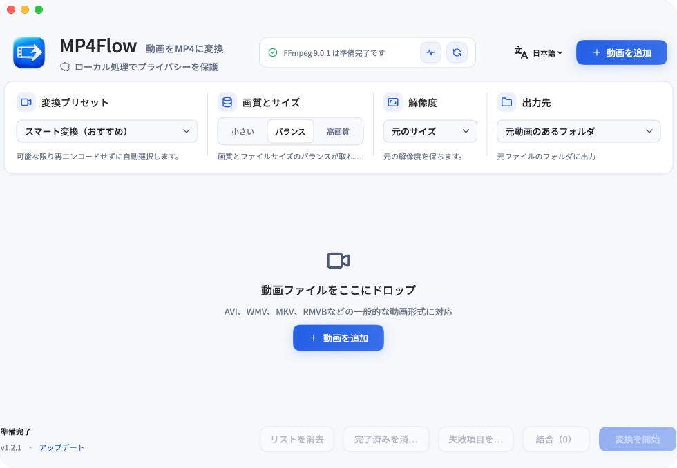

# MP4Flow

> **動画を MP4 に、とても簡単に。無料・オープンソースのネイティブ macOS 動画変換アプリです。**

[](https://github.com/ixiehao/MP4Flow/releases/latest)
[](https://github.com/ixiehao/MP4Flow/releases/latest)
[](LICENSE)

[無料でダウンロード](https://github.com/ixiehao/MP4Flow/releases/latest) · [公式サイト](https://ixiehao.github.io/MP4Flow/?lang=ja) · [English](README.md) · [简体中文](README.zh-CN.md) · [ヘルプ](SUPPORT.md)

無料、オープンソース、ローカル処理。**ログイン不要、アップロード不要、難しい設定不要。** 動画を追加し、画質を選ぶだけで Mac 上で変換できます。



## 3ステップで始める

1. [最新リリース](https://github.com/ixiehao/MP4Flow/releases/latest)から `.dmg` をダウンロードし、開いて **MP4Flow** を **Applications** にドラッグします。
2. ローカル依存関係を一度だけインストールします。`ffmpeg` と `ffprobe` の両方が入ります。

   ```sh
   brew install ffmpeg
   ```

3. MP4Flow を開き、動画を追加し、**スマート変換（推奨）** のまま **変換を開始** を選びます。

ほとんどの場合、これだけで完了です。FFmpeg やハードウェアエンコードの準備を確認したい場合は、アプリ内の **環境チェック** を開きます。

> macOS 13 Ventura 以降が必要です。Appleシリコンと Intel Mac に対応します。初回起動を macOS に止められた場合は、Control キーを押しながら MP4Flow をクリックして **開く** を選択してください。必要なら短い[ダウンロードとチェックサムの手順](docs/DOWNLOAD.md)も確認できます。

## できること

| 機能 | できること |
| --- | --- |
| **スマート変換** | 推奨の初期設定です。MP4Flow が動画に合った実用的な処理方法を選びます。 |
| **高速なローカル処理** | MP4 の直接再格納やストリームコピーによるトリミングが可能な場合、不要な再エンコードを避けます。 |
| **トリミング、クロップ、回転** | 必要な部分だけを残し、画面範囲や向きを整えて書き出せます。 |
| **動画の結合** | 同じ条件のファイルはロスレス結合、異なるファイルは画面を引き伸ばさない互換結合ができます。 |
| **解像度の選択** | 元のサイズを保つか、比率を維持して 1080p、720p、576p、480p を選べます。 |
| **プライバシーを重視** | 動画処理は Mac 上だけで行われます。アカウント、分析、動画アップロードサービスはありません。 |

### 目的に合わせて選ぶ

- 多くの機器で再生したい：**H.264** を選びます。
- 新しい機器向けにファイルを小さくしたい：**HEVC** を選びます。
- 難しい動画を安定して変換したい：**ソフトウェア互換モード** を選びます。
- 対応動画を拡大したい：実験的な **スマート高画質拡大** を試します。Appleシリコン、macOS 27 以降、かつ VideoToolbox がその正確な倍率に対応している場合のみ使えます。クロップや回転との同時利用はできず、初回利用時に macOS がシステムモデルをダウンロードすることがあります。

## 知っておくこと

- **入力ごとに出力を作成：** 既存ファイルを上書きせず、完了後は Finder で表示できます。
- **進行状況が分かる：** 素材の検査、直接再格納、ハードウェア/ソフトウェア変換、出力検証を表示します。失敗した項目は再試行できます。
- **音声、字幕、HDR：** 変換前に複数音声、字幕、HDR を知らせます。既定では最初の映像と音声トラックを出力し、コンテナメタデータとチャプターはコピーしません。機密性のある動画は共有前に書き出し結果を確認してください。
- **通常の拡大は高画質化ではありません：** 通常の拡大は寸法を変えるだけです。上のスマート高画質拡大は、システム対応時に選べるオプションです。

## よくある質問

### FFmpeg または ffprobe が見つからない

`brew install ffmpeg` を実行し、**環境チェック** の **再チェック** を選びます。MP4Flow は FFmpeg を同梱または自動ダウンロードしません。

### 動画の処理に失敗した

まず **再試行** を選びます。解決しない場合は、**スマート変換** で新しい MP4 を作成し、その新しいファイルで編集または高画質拡大を再試行してください。状態表示は可能な限り失敗した段階を示します。

### 動画を結合するには？

編集していない待機中の動画を少なくとも2つ追加し、**結合** を選びます。コーデック、フレームレート、サイズが異なる場合は **互換結合** を選択してください。

## ソースからビルド

```sh
git clone https://github.com/ixiehao/MP4Flow.git
cd MP4Flow
./Scripts/build-app.sh
open MP4Flow.app
```

貢献する場合は、FFmpeg のインストール後に `swift test` と `./Scripts/run-media-regression.sh` を実行してください。開発者向け資料：[貢献方法](CONTRIBUTING.md)、[メディア回帰テスト](docs/MEDIA-REGRESSION.md)、[インストーラ作成](docs/INSTALLER-BUILD.md)、[リリースチェックリスト](docs/RELEASE-CHECKLIST.md)。

## プライバシー、依存関係、ライセンス

- MP4Flow は Swift、SwiftUI、Apple のシステムフレームワークを使用します。[プライバシーポリシー](PRIVACY.ja.md) · [セキュリティポリシー](SECURITY.ja.md)
- FFmpeg は別途インストールするローカル実行時依存関係です。ライセンスは導入したビルドによって決まり、MP4Flow が同梱またはダウンロードすることはありません。
- スマート高画質拡大は、macOS が提供する場合に Apple のオンデバイス VideoToolbox を使用します。対応倍率とシステムモデルの配信は macOS により管理されます。
- アプリには [SIL Open Font License 1.1](AppResources/OFL.txt)の Noto Sans SC と、[MIT License](AppResources/ASSET_NOTICES.md)の [Tabler Icons Outline](https://github.com/tabler/tabler-icons) のローカル厳選セット（v3.49.0）が含まれます。

帰属表示は [NOTICE.ja.md](NOTICE.ja.md)、プロジェクトのライセンスは [LICENSE](LICENSE) を参照してください。

## 開発・保守ドキュメント

[ドキュメント一覧](docs/README.md) · [開発と検証](docs/DEVELOPMENT.md) · [公式サイトの保守](docs/WEBSITE.md)。

公式サイトのソースは `website/` に、開発・保守ドキュメントは `docs/` に置いています。
