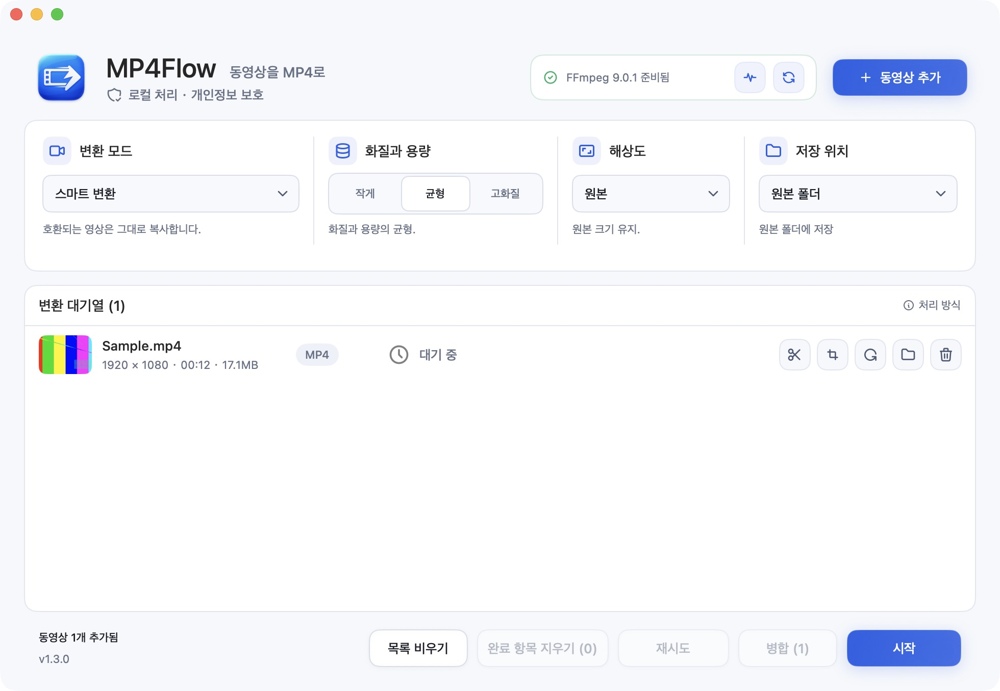

# MP4Flow

[English](README.md) · [简体中文](README.zh-CN.md) · [Français](README.fr.md) · [Русский](README.ru.md) · [Español](README.es.md) · [日本語](README.ja.md) · [한국어](README.ko.md)

**동영상을 MP4로. 쉽고 간편하게.** 무료 오픈 소스 Mac 네이티브 앱. 로그인도 영상 업로드도 필요 없어요.

[**Mac용 다운로드**](https://github.com/ixiehao/MP4Flow/releases/latest) · [공식 사이트](https://ixiehao.github.io/MP4Flow/ko/) · [문제 신고](https://github.com/ixiehao/MP4Flow/issues/new/choose)

**사용 환경:** macOS 13+ · Apple Silicon 또는 Intel Mac · FFmpeg와 ffprobe (아래 설치 방법 참고).

## 주요 기능

| 기능 | 할 수 있는 일 |
| --- | --- |
| **스마트 변환** | 불필요한 재인코딩을 줄이고, 가능한 경우 하드웨어 가속으로 빠르게 처리해요. |
| **구간 자르기** | 시작과 끝을 정해 필요한 장면만 남겨요. |
| **화면 자르기** | 화면의 불필요한 가장자리를 제거해요. |
| **회전** | 화면 비율을 유지하며 영상 방향을 바꿔요. |
| **화면 비율 보정** | 늘어난 영상을 보정해요. 실시간 미리보기와 기본·사용자 지정 비율을 지원해요. |

영상이 늘어져 보이나요? 대기열에서 **자르기와 비율 → 화면 비율 보정**을 여세요. 기본 비율을 고르거나 가로·세로 비율을 입력한 뒤, 미리보기를 확인하고 **적용**을 누르세요.

일괄 변환, 영상 병합, 해상도 변경도 지원해요. 영상은 모두 내 Mac에서 처리해요.

## 다운로드와 설치

1. **앱을 설치하세요.** [최신 버전 페이지](https://github.com/ixiehao/MP4Flow/releases/latest)에서 **Assets**를 펼쳐 **MP4Flow의 `.dmg` 설치 파일**을 다운로드하세요. 파일을 열고 **MP4Flow**를 **Applications(응용 프로그램)**로 드래그하세요.
2. **영상 도구를 한 번만 설치하세요.** Spotlight(`⌘ 스페이스`)에서 **터미널**을 찾아 여세요. Homebrew가 없다면 [공식 안내](https://brew.sh/)에 따라 설치하고 마지막의 **Next steps**까지 완료하세요. 그다음 아래 명령을 실행하세요.

   ```sh
   brew install ffmpeg
   ```

   FFmpeg와 ffprobe가 함께 설치돼요. Homebrew의 [시스템 요구 사항](https://docs.brew.sh/Installation#macos-requirements)은 MP4Flow와 별개예요.

3. **첫 영상을 변환하세요.** MP4Flow에 영상을 추가하고 **스마트 변환**을 유지한 채 화질을 고른 다음 **시작**을 누르세요.

기본 저장 위치는 원본 영상과 같은 폴더이며 기존 파일을 덮어쓰지 않아요. **폴더 열기**로 결과를 확인하세요. 앱 언어는 Mac 메뉴 막대의 **언어**에서 바꿀 수 있어요.

<details>
<summary>앱 화면 보기</summary>



</details>

## 도움이 필요하세요?

- **FFmpeg나 ffprobe를 찾지 못하나요?** 설치 후 **환경 점검 → 다시 확인**을 누르세요. MP4Flow에는 이 도구들이 포함되어 있지 않아요.
- **macOS가 실행을 막나요?** GitHub 배포본은 Apple 공증을 받지 않았어요. 다운로드 출처를 확인하고 [Apple의 실행 안내](https://support.apple.com/ko-kr/102445)를 따라 주세요.
- **변환에 실패했나요?** **재시도**를 눌러 보세요. 편집이나 스마트 확대에 실패하면 먼저 **스마트 변환**으로 새 MP4를 만든 뒤 그 파일을 추가해 다시 시도하세요. 계속 실패하면 macOS와 앱 버전, 오류 내용을 함께 [알려 주세요](https://github.com/ixiehao/MP4Flow/issues/new/choose). 비공개 영상은 첨부하지 마세요.

## 변환 전에 알아두세요

MP4Flow는 표지 이미지와 썸네일을 제외하고 첫 번째 실제 영상 트랙과 오디오 트랙을 유지해요. 컨테이너 메타데이터와 챕터는 제거해요. 추가 트랙, 자막, HDR 처리에 관한 앱 안내를 확인해 주세요.

<details>
<summary>선택 기능: 스마트 확대</summary>

실험적 기능으로, Apple Silicon과 macOS 27+, Apple VideoToolbox가 지원하는 확대 배율이 필요해요. 화면 자르기, 회전, 비율 보정과 동시에 사용할 수 없어요. 처음 사용할 때 macOS가 시스템 모델을 다운로드할 수 있어요. 일반적인 해상도 변경은 사라진 디테일을 복원하지 않아요.

</details>

## 오픈 소스와 라이선스

개발자: [ixiehao](https://github.com/ixiehao) · [MIT 라이선스](LICENSE). macOS 시스템 글꼴과 [Tabler Icons Outline](https://github.com/tabler/tabler-icons)([MIT 고지](AppResources/ASSET_NOTICES.md))을 사용해요. FFmpeg는 별도로 설치하며 라이선스는 해당 빌드에 따라 달라요.

[소스에서 빌드](docs/DEVELOPMENT.md) · [개발에 참여](CONTRIBUTING.md) · [개인정보 보호](PRIVACY.md) · [타사 고지](NOTICE.md)
