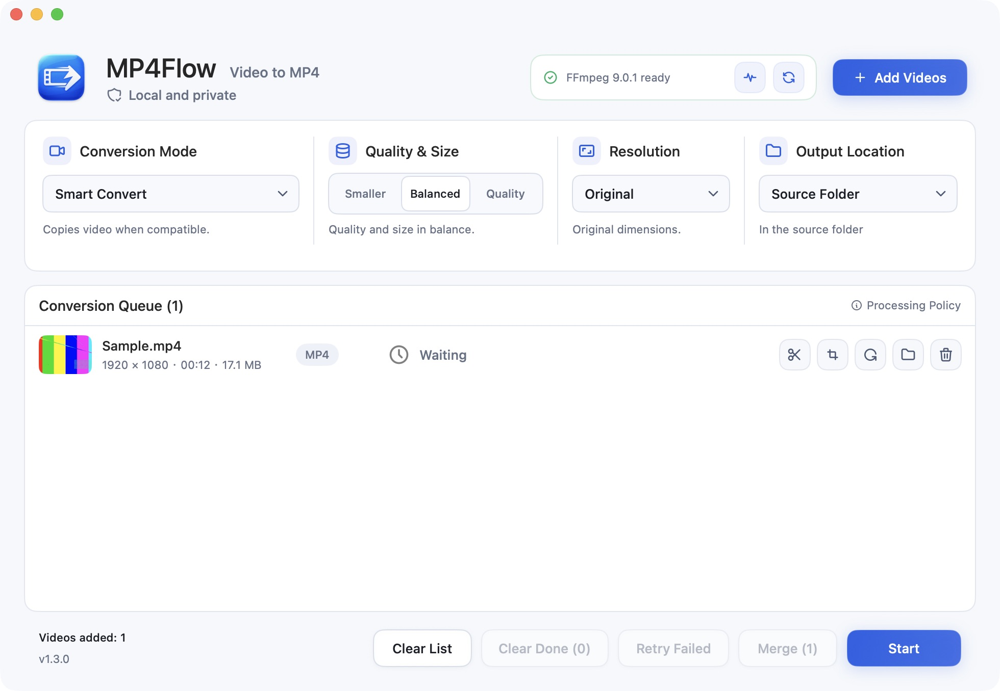

# MP4Flow

[English](README.md) · [简体中文](README.zh-CN.md) · [Français](README.fr.md) · [Русский](README.ru.md) · [Español](README.es.md) · [日本語](README.ja.md) · [한국어](README.ko.md)

**Video to MP4. Seriously simple.** A free, open-source native Mac app. No account, no video uploads.

[**Download for Mac**](https://github.com/ixiehao/MP4Flow/releases/latest) · [Website](https://ixiehao.github.io/MP4Flow/en/) · [Report an issue](https://github.com/ixiehao/MP4Flow/issues/new/choose)

**Requires:** macOS 13+ · Apple silicon or Intel · FFmpeg and ffprobe (installation below).

## What you can do

| Feature | Use it to… |
| --- | --- |
| **Smart Convert** | Create MP4s with less waiting: avoid re-encoding when possible; use hardware acceleration when available. |
| **Trim** | Keep the part you want by choosing a start and end. |
| **Crop** | Remove unwanted edges from the picture. |
| **Rotate** | Fix orientation without stretching the image. |
| **Aspect Correction** | Fix stretched video with live preview, presets and custom ratios. |

To fix stretched video, open **Crop & Aspect → Aspect Correction** in the queue. Choose a preset or enter a custom width:height ratio, preview the result, then click **Apply**.

Also convert batches, merge clips and change resolution. Video processing stays on your Mac.

## Download and install

1. **Install the app.** Open the [latest release](https://github.com/ixiehao/MP4Flow/releases/latest), expand **Assets**, and download the MP4Flow **`.dmg` installer**. Open it and drag **MP4Flow** to **Applications**.
2. **Install the video tools once.** Open **Terminal** using Spotlight (`⌘ Space`). If needed, [install Homebrew](https://brew.sh/) first and complete its **Next steps**. Then run:

   ```sh
   brew install ffmpeg
   ```

   This installs both FFmpeg and ffprobe. Homebrew has its own [system requirements](https://docs.brew.sh/Installation#macos-requirements).

3. **Convert your first video.** Open MP4Flow, add a video, keep **Smart Convert** selected, choose quality, and click **Start**.

By default, results go beside the original file, without overwriting existing files. Use **Open Folder** to find them. Switch the app language from **Language** in the Mac menu bar.

<details>
<summary>See the app</summary>



</details>

## Need help?

- **FFmpeg or ffprobe missing?** After installation, open **Environment Check → Recheck**. MP4Flow does not bundle these tools.
- **macOS blocks opening?** The GitHub build is not notarized by Apple. Verify the download source, then follow [Apple’s opening instructions](https://support.apple.com/en-us/102445).
- **A conversion failed?** Try **Retry Failed**. For an editing or enhancement failure, try **Smart Convert** first, then add the new MP4 and retry. Still stuck? [Report the error](https://github.com/ixiehao/MP4Flow/issues/new/choose) with your macOS and app versions; keep private videos private.

## Before you convert

MP4Flow skips cover art and thumbnails, keeps the first actual video and audio track, and removes container metadata and chapters. Check the app’s notices for extra tracks, subtitles and HDR handling.

<details>
<summary>Optional: Smart Enhance Upscale</summary>

Experimental enhancement requires Apple silicon, macOS 27+, and a scale supported by Apple’s VideoToolbox. It cannot be combined with crop, rotation or aspect correction. macOS may download a system model on first use. Ordinary resizing changes dimensions without restoring missing detail.

</details>

## Open source

By [ixiehao](https://github.com/ixiehao) · [MIT License](LICENSE). Uses native macOS fonts and [Tabler Icons Outline](https://github.com/tabler/tabler-icons) ([MIT notice](AppResources/ASSET_NOTICES.md)). FFmpeg is installed separately; its license depends on the build.

[Build from source](docs/DEVELOPMENT.md) · [Contribute](CONTRIBUTING.md) · [Privacy](PRIVACY.md) · [Third-party notices](NOTICE.md)
