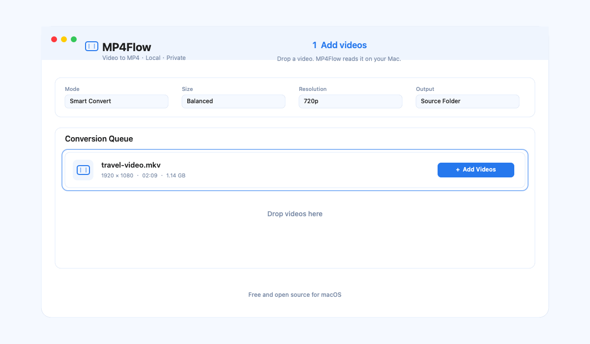

# MP4Flow

> **A free, open-source, native macOS video converter that makes MP4 simple.**

[](https://github.com/ixiehao/MP4Flow/releases/latest)
[](https://github.com/ixiehao/MP4Flow/releases/latest)
[](LICENSE)
[](https://github.com/ixiehao/MP4Flow/stargazers)

[Download MP4Flow](https://github.com/ixiehao/MP4Flow/releases/latest) · [Website](https://ixiehao.github.io/MP4Flow/) · [中文说明](README.zh-CN.md) · [Report a problem](https://github.com/ixiehao/MP4Flow/issues/new/choose)

MP4Flow converts common video files to playable MP4 **on your Mac**. It replaces codec jargon with clear choices: keep the original, save space, use a compatible format, trim, crop, rotate, or merge clips. Your videos are never uploaded, no account is required, and the app is free to use.

Beyond MP4 conversion, use MP4Flow to trim clips, crop the frame, and rotate video. We are building a fast, lightweight, free, and open-source macOS video conversion tool that feels at home on macOS.



*Add a video, make quick edits, and convert it locally.*

[Download guide](docs/DOWNLOAD.md) · [Build an installer](docs/INSTALLER-BUILD.md) · [Media regression](docs/MEDIA-REGRESSION.md) · [Release checklist](docs/RELEASE-CHECKLIST.md) · [Privacy](PRIVACY.md) · [Security](SECURITY.md)

## Download and install

1. Open the [latest GitHub Release](https://github.com/ixiehao/MP4Flow/releases/latest) and download the `.dmg` and its matching `.sha256` file.
2. Open the DMG and drag **MP4Flow** to **Applications**.
3. Install FFmpeg and ffprobe once, then use the in-app **Environment Check** to confirm they are ready:

   ```sh
   brew install ffmpeg
   ```

The release page and this repository are the official download locations. If you need to verify a download before opening it, follow the short [checksum instructions](docs/DOWNLOAD.md#verify-a-download-optional).

**Compatible Macs:** macOS 13 Ventura or later, on Apple Silicon or Intel. Hardware acceleration depends on the Mac and source codec.

## What MP4Flow does

| Need | MP4Flow approach |
| --- | --- |
| Convert a video to MP4 | Clear presets for Smart Convert, H.264 compatibility, HEVC efficiency, or a software fallback. |
| Keep processing fast | Direct MP4 remuxing and stream-copy trimming avoid re-encoding when the source allows it. |
| Make a quick edit | Trim a range, crop the frame, rotate 90°/180°, or merge clips before exporting. |
| Keep videos private | All media processing stays on the Mac. MP4Flow has no account, analytics, or video upload service. |

## Highlights

- **English and Simplified Chinese UI** — follows the system language on first launch and can be changed in the app.
- **Fast when possible** — direct MP4 remuxing and stream-copy trimming avoid re-encoding; supported H.264/HEVC scaling uses Apple VideoToolbox.
- **Clear choices** — Smart Convert, Clear and Compact, Preserve Original Quality, device-compatible H.264, smaller HEVC, and a software fallback.
- **Resolution control** — keep original dimensions or convert to 1080p, 720p, 576p, or 480p while preserving aspect ratio. Upscaling enlarges the canvas, not missing detail.
- **Experimental Smart Enhance Upscale** — on Apple Silicon running macOS 27 or later, use VideoToolbox super resolution for the exact scale factors reported by the system. It is intentionally opt-in, supports no crop or rotation yet, and may require a one-time system model download.
- **Simple editing** — trim a time range, crop with draggable handles and numeric fields, and rotate 90° or 180°.
- **Two merge modes** — lossless merging for matching streams; compatible merging normalises clips to the largest source resolution without stretching.
- **Reliable batches** — progress, retry failed items, cancellation, safe temporary outputs, and no overwrite of existing files.
- **Privacy by design** — processing stays on your Mac. Outputs are configured not to copy container metadata or chapters; review exports when sensitive redaction matters.

## Requirements

- macOS 13 Ventura or later
- [FFmpeg](https://ffmpeg.org/) and `ffprobe` installed together in `/opt/homebrew/bin`, `/usr/local/bin`, `/opt/local/bin`, or `/usr/bin`
- Apple Silicon or Intel Mac; hardware acceleration depends on the Mac and source codec
- **Smart Enhance Upscale (experimental):** Apple Silicon, macOS 27 or later, and a source/target pair that matches a VideoToolbox-supported scale factor. The system may download its model before the first use. It is not bundled with MP4Flow and does not send your video to MP4Flow or a third-party service.

Install FFmpeg with Homebrew:

```sh
brew install ffmpeg
```

## Use

1. Open MP4Flow and add video files or drag them into the queue.
2. Choose a conversion mode, quality/size, resolution, and output location.
3. Optionally use Trim, Crop, or Rotate on a waiting item.
4. Select **Start Conversion**. Completed files can be revealed in Finder.

To merge, add at least two untouched waiting files and select **Merge**. Choose **Compatible Merge** when their stream parameters differ.

## Build from source

```sh
git clone https://github.com/ixiehao/MP4Flow.git
cd MP4Flow
./Scripts/build-app.sh
open MP4Flow.app
```

The generated app is ad-hoc signed for local development. See [docs/INSTALLER-BUILD.md](docs/INSTALLER-BUILD.md) to create a distributable DMG.

## Media regression

With FFmpeg installed, run the synthetic media suite before a release:

```sh
./Scripts/run-media-regression.sh
```

It creates and removes tiny project-owned fixtures for H.264, HEVC, VFR,
portrait video, audio/subtitle variants, rotation, HDR signalling, unusual
dimensions, long-duration scheduling, special file names, and corrupt input.
See [the media regression gate](docs/MEDIA-REGRESSION.md) for its limits and
the real-device matrix required for a public release.

## Dependencies and licensing

- MP4Flow uses Swift, SwiftUI, and Apple system frameworks.
- FFmpeg is an external runtime dependency and is not bundled, downloaded, or licensed by the app. Its licence depends on the build you install.
- Smart Enhance Upscale uses Apple's on-device VideoToolbox framework when it is supported by the current Mac and macOS. Its availability, supported factors, and model delivery are controlled by the operating system.
- The bundled Noto Sans SC font is licensed under the [SIL Open Font License 1.1](AppResources/OFL.txt).
- The app bundles a curated subset of [Tabler Icons Outline](https://github.com/tabler/tabler-icons) SVGs (v3.49.0) for its interface. They are used locally, without a runtime network dependency, under the [MIT License](AppResources/ASSET_NOTICES.md).

See [NOTICE.md](NOTICE.md) for attribution, [PRIVACY.md](PRIVACY.md) for data handling, and [LICENSE](LICENSE) for the project license.
