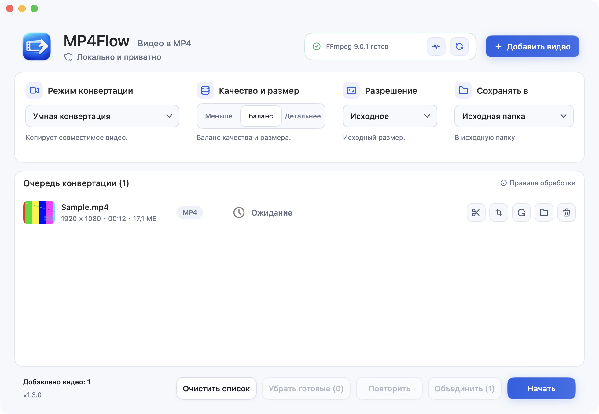

# MP4Flow

[English](README.md) · [简体中文](README.zh-CN.md) · [Français](README.fr.md) · [Русский](README.ru.md) · [Español](README.es.md) · [日本語](README.ja.md) · [한국어](README.ko.md)

**Видео в MP4. Проще простого.** Бесплатное приложение с открытым кодом, созданное для Mac. Без регистрации и загрузки видео в интернет.

[**Скачать для Mac**](https://github.com/ixiehao/MP4Flow/releases/latest) · [Официальный сайт](https://ixiehao.github.io/MP4Flow/ru/) · [Сообщить о проблеме](https://github.com/ixiehao/MP4Flow/issues/new/choose)

**Требования:** macOS 13+ · Mac с Apple Silicon или Intel · FFmpeg и ffprobe (установка ниже).

## Основные возможности

| Функция | Что она делает |
| --- | --- |
| **Умная конвертация** | Конвертируйте одно видео или целую группу. Без перекодирования, если возможно; с аппаратным ускорением, если доступно. |
| **Объединение** | Объединяйте неотредактированные клипы по порядку в очереди. Напрямую при совместимых форматах или с перекодированием для их выравнивания. |
| **Обрезка** | Задайте начало и конец, чтобы оставить нужный фрагмент. |
| **Кадрирование** | Перетащите рамку или укажите размеры, чтобы убрать лишние края. |
| **Поворот** | Поверните видео на 90° или 180° с сохранением пропорций. |
| **Коррекция пропорций** | Исправьте растяжение с предпросмотром, готовыми или своими пропорциями. |
| **Осветление** | Настройте яркость и мягко осветлите тени. Сразу оцените результат в предпросмотре. |
| **Лёгкое шумоподавление** | Уменьшите зернистость в тёмных сценах. Включайте лёгкое шумоподавление по необходимости. |

В очереди откройте **Редактор видео** для кадрирования или коррекции пропорций. Яркость и шумоподавление — в разделе **Свет и тени**. Нажмите **Применить**, затем **Начать** для экспорта.

Коррекция света требует перекодирования и недоступна для HDR. Шумоподавление изначально выключено и может слегка смягчать детали.

Также можно изменить разрешение. Вся обработка видео выполняется на вашем Mac.

## Скачать и установить

1. **Установите приложение.** Откройте [последний выпуск](https://github.com/ixiehao/MP4Flow/releases/latest), разверните **Assets** и скачайте **установщик MP4Flow с расширением `.dmg`**. Откройте файл и перетащите **MP4Flow** в **Applications («Программы»)**.
2. **Один раз установите инструменты для видео.** Через Spotlight (`⌘ Пробел`) найдите и откройте **Терминал**. Если Homebrew ещё нет, [установите его](https://brew.sh/) и выполните указания **Next steps** в конце установки. Затем запустите:

   ```sh
   brew install ffmpeg
   ```

   Команда установит FFmpeg и ffprobe. У Homebrew отдельные [системные требования](https://docs.brew.sh/Installation#macos-requirements).

3. **Конвертируйте первое видео.** Добавьте его в MP4Flow, оставьте **Умная конвертация**, выберите качество и нажмите **Начать**.

По умолчанию результат сохраняется рядом с исходным файлом без перезаписи существующих файлов. Найти его можно кнопкой **Открыть папку**. Язык приложения меняется в меню **Язык** в строке меню Mac.

<details>
<summary>Посмотреть интерфейс</summary>



</details>

## Нужна помощь?

- **Не найдены FFmpeg или ffprobe?** После установки откройте **Диагностика → Проверить снова**. Эти инструменты не входят в MP4Flow.
- **macOS блокирует запуск?** Версия с GitHub не прошла нотариальную проверку Apple. Проверьте источник загрузки и следуйте [инструкции Apple](https://support.apple.com/ru-ru/102445).
- **Ошибка конвертации?** Нажмите **Повторить**. Если не удаётся редактирование или улучшение, сначала создайте MP4 через **Умная конвертация** и добавьте новый файл. Если проблема остаётся, [сообщите об ошибке](https://github.com/ixiehao/MP4Flow/issues/new/choose), указав версии macOS и приложения. Не прикладывайте личные видео.

## Перед конвертацией

MP4Flow пропускает обложки и миниатюры, сохраняет первую настоящую видеодорожку и первую аудиодорожку, удаляет метаданные контейнера и главы. Об обработке дополнительных дорожек, субтитров и HDR сообщают уведомления в приложении.

<details>
<summary>Дополнительно: умное увеличение</summary>

Экспериментальная функция требует Apple Silicon, macOS 27+ и коэффициент увеличения, поддерживаемый Apple VideoToolbox. Её нельзя сочетать с кадрированием, поворотом, коррекцией пропорций или настройкой света. При первом использовании macOS может скачать системную модель. Обычное изменение разрешения не восстанавливает утраченные детали.

</details>

## Открытый код и лицензии

Разработчик: [ixiehao](https://github.com/ixiehao) · [Лицензия MIT](LICENSE). Используются системные шрифты macOS и [Tabler Icons Outline](https://github.com/tabler/tabler-icons) ([условия MIT](AppResources/ASSET_NOTICES.md)). FFmpeg устанавливается отдельно; его лицензия зависит от сборки.

[Сборка из исходников](docs/DEVELOPMENT.md) · [Участие в разработке](CONTRIBUTING.md) · [Конфиденциальность](PRIVACY.md) · [Сторонние компоненты](NOTICE.md)
