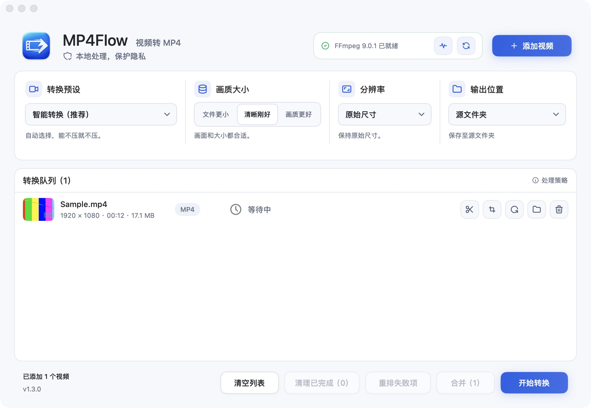

# MP4Flow

[English](README.md) · [简体中文](README.zh-CN.md) · [Français](README.fr.md) · [Русский](README.ru.md) · [Español](README.es.md) · [日本語](README.ja.md) · [한국어](README.ko.md)

**把视频变成 MP4，特别简单。** 免费、开源的原生 Mac 应用。不用登录，不用上传视频。

[**下载 Mac 版**](https://github.com/ixiehao/MP4Flow/releases/latest) · [官方网站](https://ixiehao.github.io/MP4Flow/) · [反馈问题](https://github.com/ixiehao/MP4Flow/issues/new/choose)

**运行要求：** macOS 13+ · Apple 芯片或 Intel · FFmpeg 和 ffprobe（安装方法见下方）。

## 主要功能

| 功能 | 能帮你做什么 |
| --- | --- |
| **智能转换** | 能直接转换就不重新编码，需要时利用硬件加速，减少等待。 |
| **剪切** | 选择起点和终点，只留下需要的片段。 |
| **裁切** | 去掉画面中多余的边缘。 |
| **旋转** | 调整视频方向，保持画面比例。 |
| **比例矫正** | 修正画面拉伸，支持实时预览、常用比例和自定义比例。 |

画面被拉伸？在队列中打开 **裁切与比例 → 比例矫正**，选择常用比例或输入自定义宽高比，实时预览后点击 **应用编辑**。

还支持批量转换、合并视频和调整分辨率。视频始终在你的 Mac 上处理。

## 下载与安装

1. **安装应用。** 打开[最新版本页面](https://github.com/ixiehao/MP4Flow/releases/latest)，展开 **Assets**，下载以 **`.dmg` 结尾的 MP4Flow 安装包**。打开后，将 **MP4Flow** 拖入 **Applications（应用程序）**。
2. **首次安装视频工具。** 按 `⌘ 空格`，搜索并打开「终端」。如果还没有 Homebrew，先按[官网说明](https://brew.sh/)安装，并完成安装后提示的 **Next steps**。然后运行：

   ```sh
   brew install ffmpeg
   ```

   这会同时安装 FFmpeg 和 ffprobe。Homebrew 的[系统要求](https://docs.brew.sh/Installation#macos-requirements)与 MP4Flow 分开计算。

3. **开始第一次转换。** 打开 MP4Flow，添加视频，保持「**智能转换（推荐）**」，选择画质，点击「**开始转换**」。

默认保存到原视频所在文件夹，不覆盖已有文件。点击「**打开文件夹**」即可找到结果。App 语言可在 Mac 菜单栏的「**语言**」中切换。

<details>
<summary>查看软件截图</summary>



</details>

## 遇到问题？

- **找不到 FFmpeg 或 ffprobe？** 安装后打开「**环境体检 → 重新检查**」。MP4Flow 不内置这两个工具。
- **macOS 阻止打开？** GitHub 版本尚未经过 Apple 公证。确认下载来源后，按照 [Apple 官方说明](https://support.apple.com/zh-cn/102445)允许首次打开。
- **转换失败？** 先点「**重排失败项**」。若编辑或增强失败，可先用「智能转换」生成新 MP4，再添加新文件重试。仍有问题，请[反馈错误信息](https://github.com/ixiehao/MP4Flow/issues/new/choose)，附上 macOS 和 App 版本，不要公开私密视频。

## 转换前了解一下

MP4Flow 跳过封面和缩略图，保留第一路实际视频和音频，移除容器元数据与章节。额外音轨、字幕和 HDR 的处理方式，请留意 App 中的提示。

<details>
<summary>可选功能：智能增强放大</summary>

实验性功能，需要 Apple 芯片、macOS 27+，以及 Apple VideoToolbox 支持的放大倍率。暂不能同时裁切、旋转或矫正比例；首次使用时，macOS 可能下载系统模型。普通调整分辨率只改变尺寸，不会恢复缺失的细节。

</details>

## 开源与许可

开发者：[ixiehao](https://github.com/ixiehao) · [MIT License](LICENSE)。使用 macOS 原生字体及 [Tabler Icons Outline](https://github.com/tabler/tabler-icons)（[MIT 许可说明](AppResources/ASSET_NOTICES.md)）。FFmpeg 单独安装，其许可取决于所用构建。

[从源码构建](docs/DEVELOPMENT.md) · [参与贡献](CONTRIBUTING.md) · [隐私政策](PRIVACY.md) · [第三方声明](NOTICE.md)
