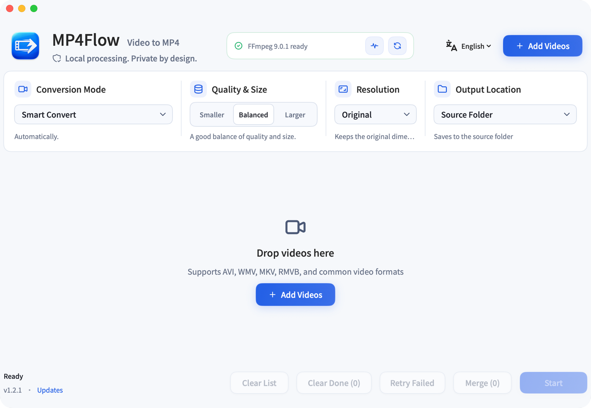

# MP4Flow

> **一款免费、开源的原生 macOS 视频转 MP4 工具：把视频变成 MP4，特别简单。**

[](https://github.com/ixiehao/MP4Flow/releases/latest)
[](https://github.com/ixiehao/MP4Flow/releases/latest)
[](LICENSE)

[免费下载](https://github.com/ixiehao/MP4Flow/releases/latest) · [官方网站](https://ixiehao.github.io/MP4Flow/) · [English](README.md) · [日本語](README.ja.md) · [获取帮助](SUPPORT.md)

免费、开源、本地处理。**不用登录、不用上传、不用会看参数。** 添加视频，选择画质，在你的 Mac 上完成转换。



## 三步上手

1. 在 [GitHub 最新版本](https://github.com/ixiehao/MP4Flow/releases/latest)下载 `.dmg`，打开后把 **MP4Flow** 拖进 **Applications（应用程序）**。
2. 安装一次本地依赖；它会同时安装 `ffmpeg` 和 `ffprobe`：

   ```sh
   brew install ffmpeg
   ```

3. 打开 MP4Flow，添加视频，保持「**智能转换（推荐）**」，点击「**开始转换**」。

大多数情况下，做到这里就可以了。若想确认 FFmpeg 或硬件编码是否可用，请在应用里打开「环境体检」。

> 需要 macOS 13 Ventura 或更高版本，支持 Apple 芯片与 Intel Mac。若 macOS 阻止首次打开，请按住 Control 点按 MP4Flow，选择「打开」。需要时可查看简短的[下载与校验说明](docs/DOWNLOAD.md)。

## 它能做什么

| 功能 | 你会得到什么 |
| --- | --- |
| **智能转换** | 推荐的默认选择；MP4Flow 会为当前文件选择合适的处理方式。 |
| **极速本地处理** | 能直接封装 MP4 或直接剪切流时，就不做不必要的重新编码。 |
| **剪切、裁切、旋转** | 截取需要的片段、调整画面范围，或修正视频方向后导出。 |
| **合并视频** | 参数相同可无损合并；参数不同可兼容合并，画面不会被拉伸。 |
| **选择分辨率** | 保持原画，或选 1080P、720P、576P、480P，始终保持宽高比。 |
| **隐私优先** | 视频始终在你的 Mac 上处理；没有账户、分析追踪或视频上传服务。 |

### 想要不同效果？

- 想让更多设备都能播放：选 **H.264**。
- 想让新设备上的文件更小：选 **HEVC**。
- 遇到难处理的视频、优先求稳：选 **软件兼容模式**。
- 想放大支持的视频：试试「**智能增强放大**」。它是实验性功能，仅在 Apple 芯片、macOS 27 或更高版本且 VideoToolbox 支持该精确倍率时可用；暂不能同时裁切或旋转，首次使用时 macOS 可能下载系统模型。

## 使用前知道这几点

- **一条输入，对应一个输出：** 不会覆盖已有文件；完成后可直接在访达中显示。
- **进度看得懂：** 会显示检测素材、快速直封装、硬件/软件转换和输出校验；失败项可重试。
- **音轨、字幕与 HDR：** 自动跳过内嵌封面和缩略图，输出第一路视频和音频；额外轨道、字幕与 HDR 的处理会有提示，不复制容器元数据或章节。处理敏感内容后，请在分享前检查导出结果。
- **普通放大不是“变清晰”：** 普通放大只改变尺寸，不会凭空补细节；系统支持时可尝试上面的智能增强放大。

## 常见问题

### 提示找不到 FFmpeg 或 ffprobe

运行 `brew install ffmpeg`，再到「环境体检」点「重新检查」。MP4Flow 不会自行打包或下载 FFmpeg。

### 某个视频处理失败了

先点「重试」。仍失败时，用「智能转换」先生成一个新 MP4，再添加这个新文件重试剪辑或增强操作。状态提示会尽可能说明失败发生在哪一步。

### 怎样合并视频？

添加至少两个未编辑、处于等待中的视频，点击「合并」。若编码、帧率或尺寸不同，请选「兼容合并」。

## 从源码构建

```sh
git clone https://github.com/ixiehao/MP4Flow.git
cd MP4Flow
./Scripts/build-app.sh
open MP4Flow.app
```

贡献代码前，请在安装 FFmpeg 后运行 `swift test` 和 `./Scripts/run-media-regression.sh`。开发资料：[参与贡献](CONTRIBUTING.md)、[媒体回归测试](docs/MEDIA-REGRESSION.md)、[安装包构建](docs/INSTALLER-BUILD.md)、[发布检查清单](docs/RELEASE-CHECKLIST.md)。

## 隐私、依赖与许可

- MP4Flow 使用 Swift、SwiftUI 与 Apple 系统框架开发。[隐私政策](PRIVACY.md) · [安全政策](SECURITY.md)
- FFmpeg 是需单独安装的本地运行时依赖；其许可证取决于你安装的构建。MP4Flow 不会打包或下载它。
- 智能增强放大在 macOS 支持时调用 Apple 设备端 VideoToolbox；支持倍率和系统模型交付由 macOS 决定。
- 应用内置 Noto Sans SC，遵循 [SIL Open Font License 1.1](AppResources/OFL.txt)；也内置 [Tabler Icons Outline](https://github.com/tabler/tabler-icons) 的本地精选子集（v3.49.0），遵循 [MIT License](AppResources/ASSET_NOTICES.md)。

归属信息见 [NOTICE.md](NOTICE.md)，项目许可证见 [LICENSE](LICENSE)。

## 开发与维护文档

[文档索引](docs/README.md) · [开发与验证](docs/DEVELOPMENT.md) · [官网维护](docs/WEBSITE.md)。

官网源码统一位于 `website/`，`docs/` 用于开发与维护文档。
